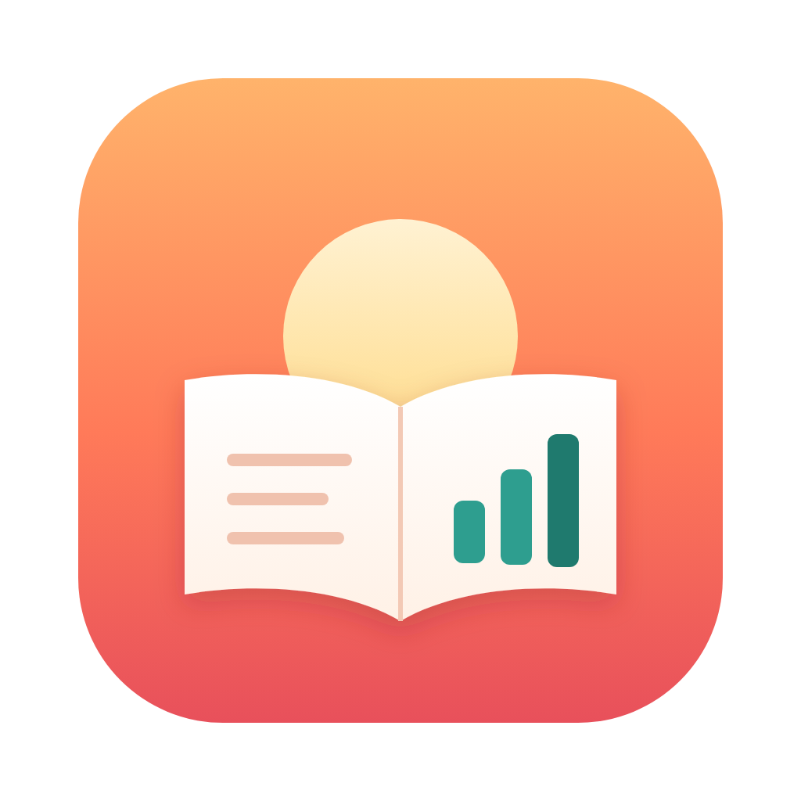

<p align="center"></p>

# 夏夏账本 · Xiaxia Ledger

一份本地账本，两个入口：

- **给人用**：原生 SwiftUI 的 Mac（之后 iPhone）app，看图表、随手记账、确认 AI 的改动。
- **给 AI 用**：`fin` 命令行（之后加 MCP），一连上就懂你的财务，能导入对账单、去重、分类、对账、出月报。

两边读写同一份数据，AI 导入后 app 里马上能看到。拿不准的事 AI 在对话里先问你，app 里不设「待确认」；每次改动都有记录，可以撤销。支持多账本（比如「个人」和「店铺」），账本间转账汇总时自动抵消。

> A local-first personal & small-business ledger for macOS. Native SwiftUI app for humans, `fin` CLI for AI agents, one shared core.

## 安装（给用的人）

1. 下载 `夏夏账本-x.y.z.dmg`（[Releases](https://github.com/srmming/xiaxia-ledger/releases)），打开后把「夏夏账本」拖进「应用程序」。
2. 打开夏夏账本，会弹出「连上你的 AI」：勾上你在用的 AI（Claude 桌面版、Claude Code、Codex、Hermes Agent、Cursor、Gemini CLI），点「连上」，再按提示重开一次那个 AI。
3. 跟 AI 说「用夏夏账本帮我记一笔：今天买咖啡花了 3,50 €」，引导页变绿就好了。

用 DeepSeek 可以装 Hermes Agent（引导里能自动连）；用别的 AI（Cherry Studio 接通义千问等）：在引导里点「复制配置」，粘进它的 MCP 设置。怎么打包和发布见 [docs/DISTRIBUTE.md](docs/DISTRIBUTE.md)。

## 隐私

这是公开仓库，**只放代码**。真实流水、对账单、账本文件一律不进仓库（见 `.gitignore`）。账本是一个 SQLite 文件，
默认在 iCloud 云盘的「夏夏账本/ledger.sqlite」（没开 iCloud 云盘就在 `~/Library/Application Support/XiaxiaLedger/`），
app 和 `fin` 读写同一份。旧的 `ledger.json` 第一次打开时会自动搬进 SQLite，原文件留作备份。

## 结构

```
Sources/
  FinanceCore/      共享核心：模型、金额（分为单位）、汇总口径、去重、存储
  fin/              命令行，给 AI 用（每个命令都支持 --json）
  XiaxiaLedgerApp/  Mac app（SwiftUI 外壳；页面按 design/ 的设计稿做）
Tests/              单元测试（只用编造数据）
design/             logo、界面设计稿
skills/fin/         给 AI 的使用说明（skill + 通用提示词 PROMPT.md），打包进 fin，fin setup 装到各 AI 工具全局
docs/               路线图和决定记录
```

## 运行（需要 macOS 14+、Xcode 16+）

```bash
swift build
swift test
swift run fin context          # 说明书：账本、账户、口径
swift run XiaxiaLedgerApp -XiaxiaDemo   # Mac 开发版，用编造的示例账本
cd App && xcodegen generate && open XiaxiaLedger.xcodeproj   # iOS / Mac 正式工程
swift run fin summary --month 2026-11 --book shop
swift run XiaxiaLedgerApp      # 打开 Mac app（也可以用 Xcode 打开 Package.swift 再运行）
```

用 `XIAXIA_LEDGER_PATH=/path/to/test.json` 可以指向一份测试账本。

### 示例账本（全是编的）

开发、检查、截图、给别人演示，一律用示例账本，不碰真实账本：

```bash
swift run fin demo --out ~/Desktop/示例账本.sqlite      # 一键生成：今天为止 13 个月
XIAXIA_LEDGER_PATH=~/Desktop/示例账本.sqlite swift run fin report
swift run XiaxiaLedgerApp -XiaxiaDemo                   # app 的示例模式用的是同一份
```

一个虚构的人：有份兼职工资，自己开一家小花店（带咖啡角）。两个账本（个人、我的小店），8 个账户（日常卡、信用卡、电子钱包、现金、应急金储蓄罐、店里账户、店里现金、私房钱），
覆盖所有功能：各类收支和淡旺季、还信用卡 / 充值 / 取现 / 老板提款、账本间转账、退款、订阅（涨价的、停掉的、没登记的）、
两个分期（一个带手续费）、借出 / 借入 / 逾期 / 已还清、四个存钱目标（储蓄罐、划出、锁定、店里的）、夏夏建议、改动记录（导入、手记、改分类、分账本、撤销）、还没整理的几笔。
银行、商户、人名都是编的。生成代码在 `Sources/FinanceCore/DemoData.swift`，同一个「今天」和种子生成的账本一模一样（`--seed` 换一套）。

## 现在能做什么

| 命令 | 状态 |
| --- | --- |
| `fin context` / `books` / `accounts` / `tx` / `summary` | ✅ 可用 |
| `fin debts` / `installments` / `goals`（谁欠我钱、分期、目标和储蓄，只读） | ✅ 可用 |
| `fin add`、`fin debt add` / `repay`（记一笔、记欠款、记还款）、`fin account add [--private]`（私房钱） | ✅ 可用 |
| `fin history` / `undo`（改动记录、撤销） | ✅ 可用 |
| iPhone + Mac app（App/，XcodeGen 生成工程） | 🚧 第一版界面 |
| `fin import`（Revolut CSV、通用 CSV，自动去重）、`categorize`、`assign`、`transfer link/new` | ✅ 写好，待 Mac 上编译验证 |
| `fin mcp`（MCP 服务，给 Claude 桌面版、Codex、DeepSeek 用） | ✅ 写好，待验证 |
| 所有写入命令都能加 `--dry-run` 预演 | ✅ |

路线图见 [docs/ROADMAP.md](docs/ROADMAP.md)。

## 许可

闭源，保留所有权利，见 [LICENSE](LICENSE)。未经作者许可不得使用、复制或分发。
